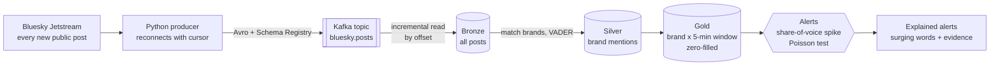

# Brand Pulse

**Which brands are having a bad day on Bluesky right now, and why?**

Every new public post on Bluesky streams from a laptop into Kafka, then through Spark on Databricks into Delta tables. Brand Pulse finds mentions of 31 Canadian and global brands, scores their mood, and raises an alert when a brand's share of the conversation jumps well above its own recent baseline. Each alert explains itself with the words that surged and links to the posts behind it.

Built for fun, to answer one question: *when a brand has a bad day, how fast does it show up in public?*

## How this differs from the usual version

Streaming social posts through Kafka and Spark to score brand sentiment is a common project. Most versions stop once a dashboard shows numbers. This one asks whether those numbers, and the alerts built on them, can be trusted, and measures the answer.

| Most versions | Brand Pulse | Measured result |
|---|---|---|
| Replay a static or simulated dataset | Streams every new public Bluesky post, live | 359,699 posts in one evening |
| Count every keyword hit as a mention | Separates deal bots and affiliate ads from real conversation | 17% of brand mentions were bots or ads; 30% of Amazon's |
| Count shared links as conversation | A link is not a mention: URLs are removed before matching | Matches fell by about a third; a false Spotify alert disappeared |
| Alert on raw volume or a fixed threshold | Compares each brand's share of voice with its own baseline, with a Poisson tail test | False alerts went from 1 to 0 |
| Plain keyword matching | Handles ambiguous names (Rogers vs Fred Rogers, TD vs touchdown, Tesla vs Nikola Tesla) | Each case is a unit test; 45 tests in total |
| A stream that never has to finish | Offset-tracked incremental batch reads | Exactly once, and every run ends in about 2 minutes on Databricks serverless |

What this does not claim: it has not been benchmarked head to head against other systems, and one quiet evening is not enough to measure alert precision. Those limits are listed below.

## Results: first live run (22 November 2026, 5:14 pm to 7:58 pm Montreal time)

| | |
|---|---|
| Public posts processed | **359,699** (about 35 a second, every language) |
| Duplicate Kafka deliveries caught | 8 in the first 351,125, removed by post URI |
| Brand mentions found | **1,824** across 18 of the 31 brands |
| Of those, deal bots and affiliate ads | **303 (17%)**, rising to **30% of Amazon's** 994 |
| Brand windows scored (5 minutes each) | 1,054 |
| Alerts on the final rules | **0** on a quiet Sunday evening |

Most negative conversation among brands with 50+ real mentions: **Uber (52% negative)** and **Delta Air Lines (49%)**, against 25 to 28% for OpenAI, Netflix, Spotify and Microsoft.

### What the live data taught me

The first version looked fine in tests and was wrong on real data in three ways. Each fix is in the code and covered by a test.

1. **Amazon's "conversation" was mostly bots.** The first run counted 1,253 Amazon mentions. Sampling them showed deal bots and affiliate posts ("only $9.92 (Reg $14.17) amzn.to/..."). They are now kept in silver but excluded from counts and alerts (`PROMO_PATTERN` in `brandpulse/match.py`).
2. **A link is not a mention.** The first alert fired: Spotify, 16 mentions against 4.9 expected. Reading the posts showed it was mostly people sharing songs (`open.spotify.com/track/...`). URLs are now removed before matching. That cut total matches by about a third (2,668 on 351,125 posts before, 1,824 on 359,699 after) and removed the false alert.
3. **Streaming jobs that never finish.** On Databricks serverless, `availableNow` streams read everything and then kept running, so a scheduled job could never end. Bronze is now an incremental batch read that stores each record's Kafka partition and offset and starts the next run one past the last offset: exactly once, and it always terminates.

## How it works



| Layer | Table | Built by |
|---|---|---|
| Bronze | `bronze_posts`: every post, decoded from Avro, with Kafka partition and offset | incremental batch, resumes one past the last offset |
| Silver | `silver_mentions`: one row per post and brand, with sentiment | incremental by Kafka time, pandas UDFs |
| Gold | `gold_brand_windows`: per brand, per 5-minute window, with platform volume | batch rebuild |
| Alerts | `alerts`, `alerts_explained` | `applyInPandas` per brand, then term analysis |

## Design decisions

**Share of voice, not raw counts.** Bluesky's total volume swings through the day. If alerts used raw mention counts, every brand would "spike" together whenever the whole platform got busy. Brand Pulse compares each brand's mentions per platform post with its own trailing hour, so a global surge moves nothing (tested in `tests/test_anomaly.py`).

**An alert has to clear four bars.** At least 30 minutes of baseline, at least 8 mentions, at least 3x the expected count, and a Poisson tail probability below 0.001. A spike is labelled *negative* only if the share of negative posts also rises 15 points above the brand's own baseline.

**Ambiguous names are handled, and tested.** A naive match on "Rogers" counts Fred Rogers, "TD" counts touchdowns, and "Tesla" counts Nikola Tesla. Aliases match only as whole words (including @handles and #tags), short acronyms only in capitals, and exclude phrases remove known false positives. See `tests/test_match.py` and `watchlist.yml`.

**Every alert explains itself.** The surging words come from weighted log-odds with an informative Dirichlet prior (Monroe, Colaresi and Quinn, 2008), comparing the alert window with the same brand's baseline posts. The three most negative posts are linked as evidence.

**Honest about language.** VADER is an English lexicon. French posts count toward volume but get no sentiment score, rather than a confident wrong one.

**Lossless reconnects.** The producer tracks Jetstream's cursor and resumes from it after a dropped connection.

## Run it

You need a Confluent Cloud cluster with Schema Registry, a Databricks workspace (Free Edition works) and Python 3.10+.

```bash
python -m venv .venv && source .venv/bin/activate
pip install -r producer/requirements.txt

# 1. Look at the live stream, no Kafka needed
python producer/jetstream_to_kafka.py --dry-run --minutes 1

# 2. Produce to Kafka (fill in .env first)
cp .env.example .env
python producer/jetstream_to_kafka.py
```

In Databricks: add this repo as a Git folder, store the Kafka API key and secret in a secret scope called `confluent` (keys `api_key`, `api_secret`), fill in the bootstrap server box at the top of `notebooks/brand_pulse_pipeline.py`, and run it. Schedule it as a job every 10 minutes for a near-live view. Dashboard queries are in `sql/dashboard.sql`.

Tests run without any cloud account:

```bash
pip install -r requirements-dev.txt pyspark vaderSentiment
pytest -q
```

## Limits

- Bluesky is not the whole internet. Its users skew toward certain communities, so this measures conversation on Bluesky, not public opinion.
- VADER misses sarcasm and is English-only.
- Runs are near-real-time (a scheduled job every few minutes), not sub-second.
- Thresholds were set by reasoning, not tuned on labelled incidents. Measuring alert precision against real outages is the next step.

## Stack

Bluesky Jetstream · Apache Kafka (Confluent Cloud) · Schema Registry · Avro · PySpark · pandas UDFs · Databricks (serverless, Unity Catalog) · Delta Lake · VADER

---

Built by [Tasnim Hassan](https://tasnimrh.github.io).
