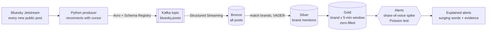

# Brand Pulse

**Which brands are having a bad day on Bluesky right now, and why?**

Every new public post on Bluesky streams from a laptop into Kafka, then through Spark on Databricks into Delta tables. Brand Pulse finds mentions of 31 Canadian and global brands, scores their mood, and raises an alert when a brand's share of the conversation jumps well above its own recent baseline. Each alert explains itself with the words that surged and links to the posts behind it.

Built for fun, to answer one question: *when a brand has a bad day, how fast does it show up in public?*

## Results

_First live run: to be filled in from the `alerts_explained` table (posts processed, alerts raised, a worked example, and matching precision from the hand-labelled audit sample)._

## How it works



| Layer | Table | Built by |
|---|---|---|
| Bronze | `bronze_posts`: every post, decoded from Avro | Structured Streaming, `availableNow` |
| Silver | `silver_mentions`: one row per post and brand, with sentiment | Structured Streaming + pandas UDFs |
| Gold | `gold_brand_windows`: per brand, per 5-minute window, with platform volume | batch rebuild |
| Alerts | `alerts`, `alerts_explained` | `applyInPandas` per brand, then term analysis |

## Design decisions

**Share of voice, not raw counts.** Bluesky's total volume swings through the day. If alerts used raw mention counts, every brand would "spike" together whenever the whole platform got busy. Brand Pulse compares each brand's mentions per platform post with its own trailing hour, so a global surge moves nothing (tested in `tests/test_anomaly.py`).

**An alert has to clear four bars.** At least 30 minutes of baseline, at least 8 mentions, at least 3x the expected count, and a Poisson tail probability below 0.001. A spike is labelled *negative* only if the share of negative posts also rises 15 points above the brand's own baseline.

**Ambiguous names are handled, and tested.** A naive match on "Rogers" counts Fred Rogers, "TD" counts touchdowns, and "Tesla" counts Nikola Tesla. Aliases match only as whole words (including @handles and #tags), short acronyms only in capitals, and exclude phrases remove known false positives. See `tests/test_match.py` and `watchlist.yml`.

**Every alert explains itself.** The surging words come from weighted log-odds with an informative Dirichlet prior (Monroe, Colaresi and Quinn, 2008), comparing the alert window with the same brand's baseline posts. The three most negative posts are linked as evidence.

**Honest about language.** VADER is an English lexicon. French posts count toward volume but get no sentiment score, rather than a confident wrong one.

**Lossless reconnects.** The producer tracks Jetstream's cursor and resumes from it after a dropped connection.

## Run it

You need a Confluent Cloud cluster with Schema Registry, a Databricks workspace (Free Edition works) and Python 3.10+.

```bash
python -m venv .venv && source .venv/bin/activate
pip install -r producer/requirements.txt

# 1. Look at the live stream, no Kafka needed
python producer/jetstream_to_kafka.py --dry-run --minutes 1

# 2. Produce to Kafka (fill in .env first)
cp .env.example .env
python producer/jetstream_to_kafka.py
```

In Databricks: add this repo as a Git folder, store the Kafka API key and secret in a secret scope called `confluent` (keys `api_key`, `api_secret`), fill in the bootstrap server box at the top of `notebooks/brand_pulse_pipeline.py`, and run it. Schedule it as a job every 10 minutes for a near-live view. Dashboard queries are in `sql/dashboard.sql`.

Tests run without any cloud account:

```bash
pip install -r requirements-dev.txt pyspark vaderSentiment
pytest -q
```

## Limits

- Bluesky is not the whole internet. Its users skew toward certain communities, so this measures conversation on Bluesky, not public opinion.
- VADER misses sarcasm and is English-only.
- `availableNow` runs are near-real-time (every few minutes), not sub-second.
- Thresholds were set by reasoning, not tuned on labelled incidents. Measuring alert precision against real outages is the next step.

## Stack

Bluesky Jetstream · Apache Kafka (Confluent Cloud) · Schema Registry · Avro · PySpark Structured Streaming · pandas UDFs · Databricks (serverless, Unity Catalog) · Delta Lake · VADER

---

Built by [Tasnim Hassan](https://tasnimrh.github.io).
